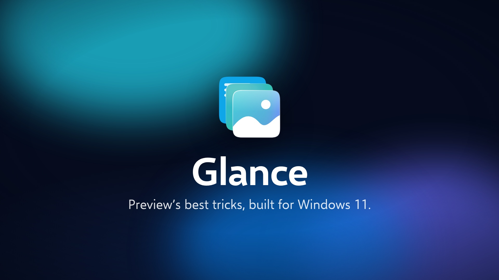
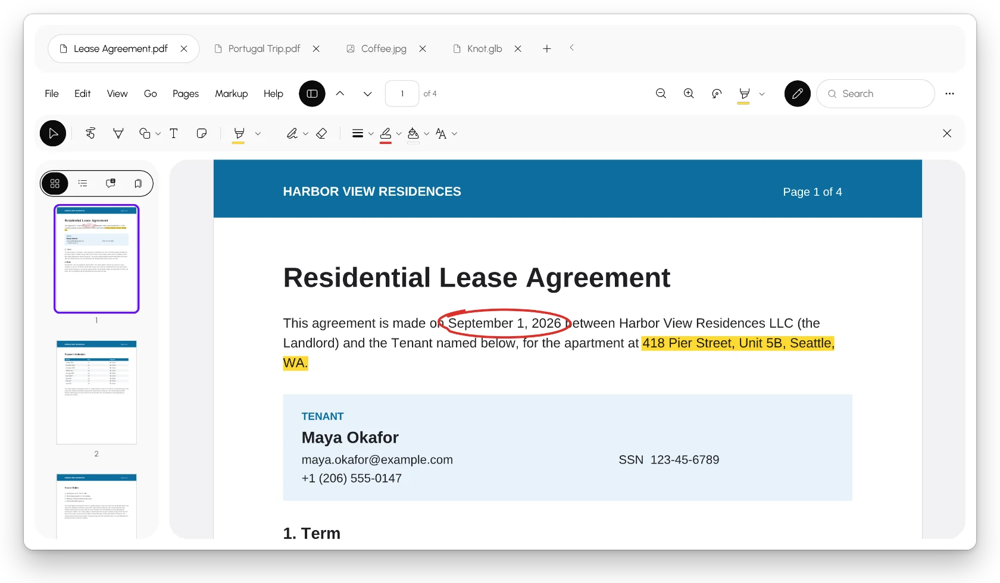
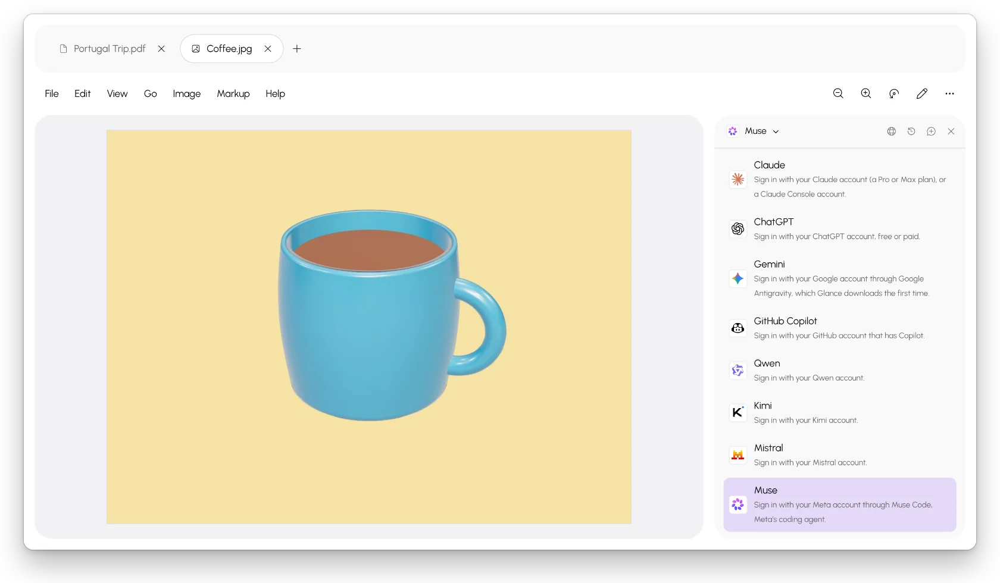
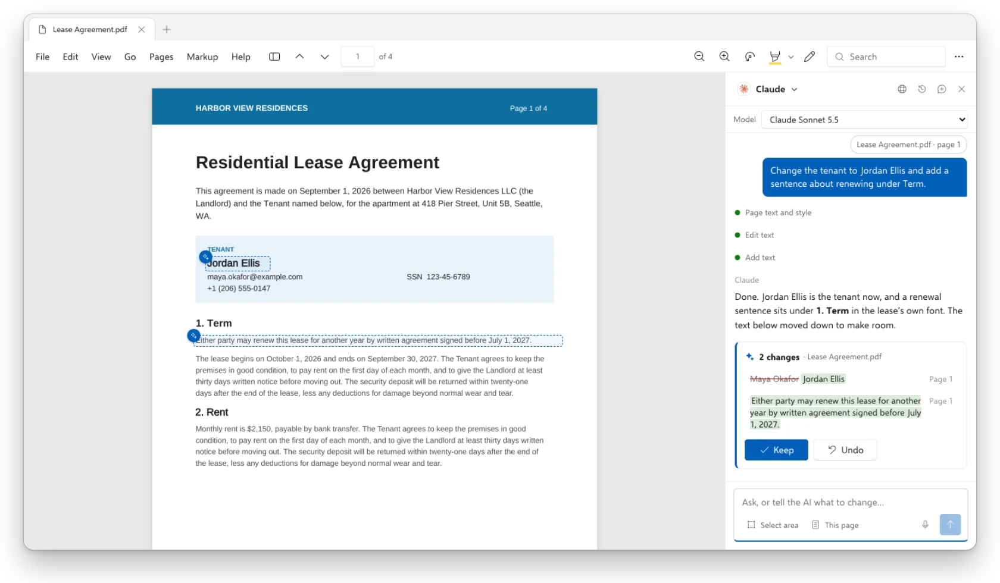
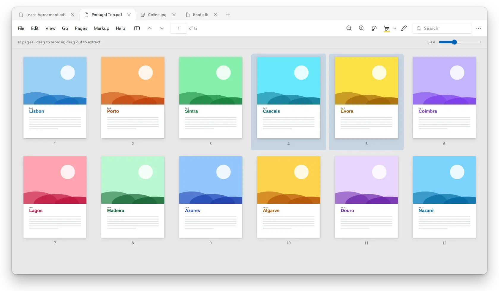
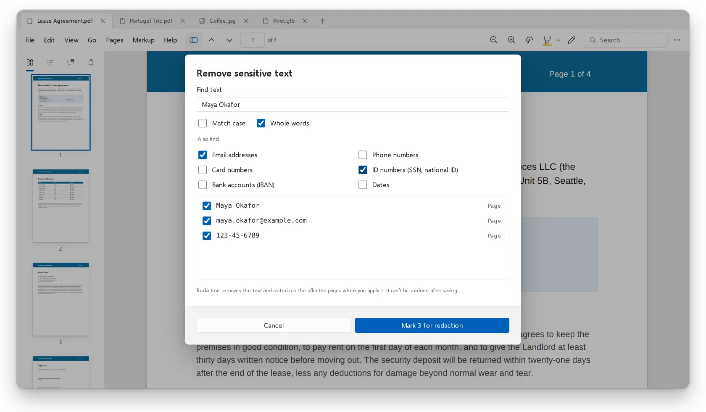
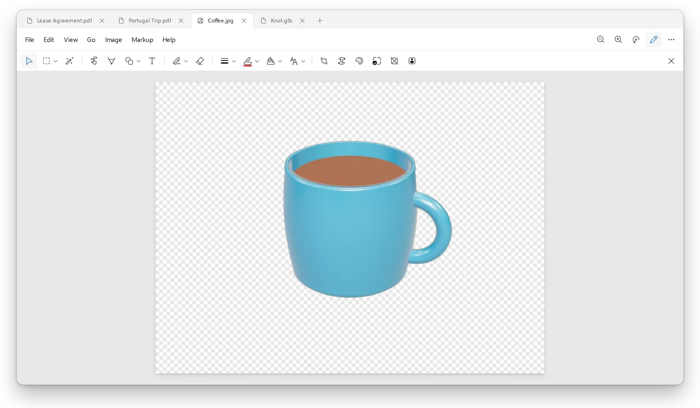
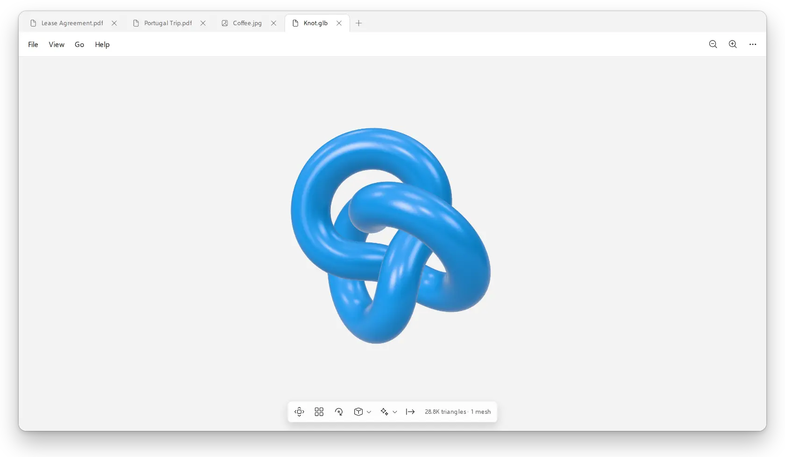

<p align="center"></p>

<p align="center">
  <a href="https://github.com/RedtRocks/glance/releases/latest"></a>
  
  
  <a href="https://apps.microsoft.com/detail/9N01BTLDS9X1"></a>
  <a href="LICENSE"></a>
</p>

<h3 align="center">Every file in one reader, with AI built in.</h3>

<p align="center">
  Glance is a free, open-source app that opens PDFs, photos, camera RAW, Office files, 3D models and <a href="docs/FORMATS.md">190+ other file types</a>, lets you mark them up and edit them, and has an AI assistant and agent built in. It runs on Windows, Linux and in any browser.
</p>

<p align="center">
  <a href="https://github.com/RedtRocks/glance/releases/latest"><b>⬇&nbsp; Download for Windows</b></a>
  &nbsp;·&nbsp;
  <a href="https://apps.microsoft.com/detail/9N01BTLDS9X1"><b>Microsoft Store</b></a>
  &nbsp;·&nbsp;
  <a href="https://redtrocks.github.io/glance/app/"><b>Open in your browser</b></a>
  &nbsp;·&nbsp;
  <a href="https://redtrocks.github.io/glance/">Website</a>
</p>

<p align="center">
<picture>
  <source media="(prefers-color-scheme: dark)" srcset="assets/screenshots/markup-dark.webp">
  
</picture>
</p>

## What it does

- **Opens anything.** One window and one set of controls for every file, instead of a different app for each type.
- **Answers questions about it.** The Ask AI sidebar talks to Claude, ChatGPT, Gemini, Copilot and others about the page you're on, signed in with your own account.
- **Does the work for you.** Say or type a change and the AI edits a PDF's text in place, in the document's own font. AI apps such as Claude Code and Codex can [use Glance as a tool](docs/AI-APPS.md).
- **Edits without another app.** Rearrange and merge PDF pages, mark up, sign, fill forms, redact for real, remove backgrounds and fix photos.

It's free, has no ads or account, and keeps your files on your device ([privacy](#privacy)).

## Get Glance

| Where | How |
|---|---|
| **Windows 10 and 11** | [Download the installer](https://github.com/RedtRocks/glance/releases/latest) (under 20 MB, x64 and ARM64) or get it from the [Microsoft Store](https://apps.microsoft.com/detail/9N01BTLDS9X1) |
| **Any browser**, phones, Macs and Chromebooks included | Open [redtrocks.github.io/glance/app](https://redtrocks.github.io/glance/app/). It installs from the browser menu and works offline |
| **Linux** | `.deb`, `.rpm` and Flatpak on the [latest release](https://github.com/RedtRocks/glance/releases/latest) ([install steps](#install-on-linux)) |

## A quick tour

<table>
  <tr>
    <td width="50%" valign="top">
<picture>
  <source media="(prefers-color-scheme: dark)" srcset="assets/screenshots/ai-choice-dark.webp">
  
</picture>
      <h3>Ask the AI you already use</h3>
      Claude, ChatGPT, Gemini, Copilot and more sit next to your file, signed in with your own account. Ask about the whole page or an area you select.
    </td>
    <td width="50%" valign="top">

      <h3>Tell it what to change</h3>
      Type or say what you want and the AI edits the PDF's text in place, in the document's own font. Keep or undo each change.
    </td>
  </tr>
  <tr>
    <td width="50%" valign="top">
<picture>
  <source media="(prefers-color-scheme: dark)" srcset="assets/screenshots/pages-dark.webp">
  
</picture>
      <h3>Pages you can grab</h3>
      Reorder, rotate, merge and split by dragging thumbnails. Drag pages into another tab to combine documents, or out of the window to make a new PDF.
    </td>
    <td width="50%" valign="top">
<picture>
  <source media="(prefers-color-scheme: dark)" srcset="assets/screenshots/redact-dark.webp">
  
</picture>
      <h3>Redaction that really removes</h3>
      Remove Sensitive Text finds names, emails, phone, card and ID numbers. Applying it deletes the text underneath, not just covers it.
    </td>
  </tr>
  <tr>
    <td width="50%" valign="top">
<picture>
  <source media="(prefers-color-scheme: dark)" srcset="assets/screenshots/alpha-dark.webp">
  
</picture>
      <h3>Instant Alpha and Remove Background</h3>
      Click to cut a background away (Shift adds, Alt subtracts), or let the bundled AI model find the subject. Everything runs on your PC.
    </td>
    <td width="50%" valign="top">
<picture>
  <source media="(prefers-color-scheme: dark)" srcset="assets/screenshots/model-dark.webp">
  
</picture>
      <h3>3D models too</h3>
      GLB, glTF, OBJ, STL, FBX, USDZ and more: orbit, wireframe, turntable, lighting and materials, with a snapshot when you need a still.
    </td>
  </tr>
</table>

## Everything it can do

Click a group to open it. Everything listed works today.

<details>
<summary><b>Opening and reading files</b></summary>

- Tabs, drag-and-drop to open, Open with / Send to, one window for everything, menus that fit each file type
- PDFs: continuous, single or two-page view, zoom, sharp HiDPI rendering, text selection, links, search, print, slideshow and a dark mode for pages
- Thumbnails, table of contents, contact sheet, Highlights & Notes sidebar and bookmarks
- Images: JPEG, PNG, GIF, WebP, AVIF, HEIC, JPEG XL, TIFF, PSD, OpenEXR, SVG, camera RAW and many more
- Read-only previews of Word, PowerPoint, Excel and CSV (old 97-2003 `.doc`, `.ppt` and `.xls` too), with Open with… to edit them in Office
- Previews of text and code (with syntax colours), Markdown, video, audio, EPUB e-books, fonts and email (`.eml`, `.msg`). Nothing in them loads from the internet
- 3D models: GLB/glTF, OBJ, STL, PLY, 3MF, DAE, FBX, USDZ and 3DS, with camera views, wireframe, turntable, lighting, backgrounds, clay/normals/X-ray materials, ground shadow, grid, animations and snapshots
- Text recognition (Windows OCR): scanned PDFs become searchable and selectable, and you can copy text from images
- The full list of file types is in [docs/FORMATS.md](docs/FORMATS.md)

</details>

<details>
<summary><b>AI assistant and agent</b></summary>

- **Ask AI sidebar:** chat with Claude, ChatGPT, Gemini, GitHub Copilot, Qwen, Kimi, Mistral, Meta's Muse or OpenCode about the open file (the whole page or a selected area), signed in with your own account or an API key, or use the company's website in the sidebar. Chats are kept per document
- **AI edits:** type or say what to change and the AI rewrites a PDF's text in place, in the document's own font, with Keep and Undo for each change
- **AI apps:** Claude Code, Claude Desktop, Codex, Antigravity, Muse Code, Cursor, VS Code and any MCP app can view any format, read text with OCR, convert, combine, split and redact files, and see and control what's open in Glance. One-click setup in Settings → AI apps ([how it works](docs/AI-APPS.md))

</details>

<details>
<summary><b>PDF pages, markup, forms and signatures</b></summary>

- Reorder, rotate, delete, duplicate, insert, split and merge pages, with undo and redo
- Drag pages between documents (hover a tab to open it; Shift moves instead of copying) or out of the window to make a new PDF
- Export pages as PDF, PNG, JPEG or TIFF (72-600 ppi)
- Markup: sketch with shape recognition, draw, shapes, arrows, speech bubbles, a loupe, text boxes in any installed font, notes, and highlight, underline and strikethrough in any colour. Saved as standard PDF annotations you can keep editing
- Fill in PDF forms
- Signatures drawn with a mouse or pen (with pressure), captured with the camera, or imported from a photo, stored encrypted
- Certificate signatures (Adobe, DocuSign and others): a banner says whether each is valid, who signed and when, and whether the document changed since. Sign with your own certificate or smart card
- Redaction that truly removes content, and Remove Sensitive Text to find names, emails, phone, card and ID numbers
- Page numbers, headers, footers and watermarks; password-protected export (AES-256); Reduce File Size; Clean Up PDF
- Autosave and version history (File → Browse Versions)

</details>

<details>
<summary><b>Photos and images</b></summary>

- Remove Background and Copy Subject with a bundled AI model that runs on your PC
- Instant Alpha (Shift adds, Alt subtracts); rectangle, ellipse, lasso and smart-lasso selection; crop, delete and invert selection
- Adjust Color: exposure, contrast, highlights, shadows, saturation, temperature, tint, sepia, sharpness, levels with a histogram and Auto Levels, with live preview
- Adjust Size, rotate, flip and Straighten with a grid overlay
- Markup on images; export as PNG, JPEG, WebP, TIFF, BMP or PDF, optionally converted to Display P3, Adobe RGB or Gray
- Inspector (Ctrl+I) for EXIF, colour profile and PDF properties, with Remove Location
- Batch Edit Images, Create Collage, New from Clipboard, Import from Scanner, Set as desktop background or lock screen

</details>

<details>
<summary><b>Look, shortcuts and Windows integration</b></summary>

- Customise tab: colour-wheel window colours with gradients and grain, tabs on top or down the side, collapsible tabs, and the Glance (Wollo) or Windows 11 look
- Context-aware toolbar you can customise, and rebindable keyboard shortcuts (Windows conventions, common Mac shortcuts, Photoshop-style single-key tools)
- Touchpad and touchscreen gestures: pinch to zoom, double-tap, swipe between pages and photos, two-finger orbit for 3D models
- Explorer right-click menu: Open in Glance, Combine into PDF, Remove Location Info. Explorer thumbnails for PDF, RAW, PSD and more
- Windows share sheet, Send to, and update notices you can skip or turn off
- Follows the Windows display language (English only so far; [translations welcome](#contributing))
- No quick-look popup on purpose: pair Glance with [PowerToys Peek](https://learn.microsoft.com/windows/powertoys/peek) (Ctrl+Space in Explorer) and press Enter to continue in Glance

</details>

## Privacy

No accounts, and nothing you open leaves your device. Text recognition and background removal run on your PC. Glance sends two optional things, both off with a switch in Settings: a daily check for a newer release on GitHub (the Microsoft Store version leaves updates to the Store), and an anonymous daily count of installs (version number only, no ID and nothing you open). AI apps you connect in Settings → AI apps send what they read through Glance to their own AI provider, and Ask AI sends what you share in the sidebar to the AI company you pick. Details are in [PRIVACY.md](PRIVACY.md).

## FAQ

<details>
<summary><b>Is Glance free?</b></summary>

Yes. It's free and open source under the Apache-2.0 license, with no ads, account or paid tier.
</details>

<details>
<summary><b>Can Glance edit PDFs?</b></summary>

It can reorder, rotate, delete, split and merge pages, fill forms, add text, shapes, highlights, notes and signatures, sign with a certificate, and permanently redact text. Ask AI can also rewrite existing text in place. It isn't a full word processor for PDFs.
</details>

<details>
<summary><b>Can I use it on a phone, a Mac or a Chromebook?</b></summary>

Yes, in the browser: open [redtrocks.github.io/glance/app](https://redtrocks.github.io/glance/app/) and install it from the browser menu if you like. It works offline and your files stay on the device. A few things need the Windows app: text recognition, scanning, Explorer integration, the Windows share sheet, certificate signatures, PostScript and XPS files, and autosave (in the browser, saving downloads the file).
</details>

<details>
<summary><b>Can I ask an AI about a document I have open?</b></summary>

Yes, in the Windows app. Press **Ask AI** to chat with Claude, ChatGPT, Gemini and others in a sidebar about the page you're on or an area you select. Sign in with your own account or paste an API key. What you share goes to the AI company you picked.
</details>

<details>
<summary><b>Can AI apps like Claude Code or Codex use Glance?</b></summary>

Yes. Connect them in **Settings → AI apps** and they can view, read, convert, combine, split and redact your files through Glance, and see the page you have open. See [docs/AI-APPS.md](docs/AI-APPS.md).
</details>

<details>
<summary><b>Can I sign on a nearby iPhone or iPad?</b></summary>

Not on Windows. Draw your signature, capture it with the camera, or import a photo of it instead.
</details>

## Install on Linux

Glance builds for Ubuntu 22.04+ and Debian 12+ (`.deb`) and Fedora 42+ (`.rpm`), on x86_64 and ARM64. Download the file for your system from the [latest release](https://github.com/RedtRocks/glance/releases/latest) and install it:

```sh
sudo apt install ./Glance-<tag>-linux-amd64.deb                  # Ubuntu or Debian
sudo dnf install ./Glance-<tag>-linux-x86_64.rpm                 # Fedora
flatpak install --user ./Glance-<tag>-linux-x86_64.flatpak       # any other distribution
```

ARM64 files end in `-arm64.deb`, `-aarch64.rpm` and `-aarch64.flatpak`.

<details>
<summary>More about the Linux version</summary>

The `.deb` and `.rpm` install `glance` and `glance-mcp` in `/usr/bin` and register Glance for its file types. Install `ghostscript` (recommended by the package) for PostScript and EPS. The Flatpak can't open PostScript or EPS because Ghostscript isn't bundled; use the `.deb` or `.rpm` for those.

Not on Linux yet: text recognition, scanning, certificate signatures, Open With and default apps from inside Glance, Set as Wallpaper, the share sheet, speech input, XPS and JPEG XR. Saved signatures and AI API keys are stored in your login keyring (Secret Service, such as GNOME Keyring or KWallet).

To build the packages yourself, install the Tauri prerequisites (on Fedora: `sudo dnf install gcc gcc-c++ clang webkit2gtk4.1-devel openssl-devel librsvg2-devel libxdo-devel nodejs npm`), then run `npm install && npx tauri build --bundles rpm` (or `--bundles deb`). The output lands in `src-tauri/target/release/bundle/rpm` or `.../deb`. Building the Flatpak is described in `packaging/README.md`.

</details>

## For developers

<details>
<summary><b>Why it's small and fast</b></summary>

- **Tauri 2 + WebView2**: the UI runs in the Edge engine already built into Windows 10/11, so Glance doesn't ship its own browser. The installer is under 20 MB (about 18 MB for x64).
- **Rust backend**: file access and image decoding run natively. Windows' own codecs come first ([WIC](docs/adr/0010-native-first-decoding.md)), so camera RAW and HEIC work whenever Windows supports them.
- **Lazy engines**: the startup bundle is ~35 KB gzipped. PDF.js loads only when you open a PDF, pdf-lib only when you first edit one, and the 3D engine only for models.

</details>

<details>
<summary><b>Build from source</b></summary>

Requirements: Node.js 22+, Rust (stable), and on Windows the WebView2 runtime (preinstalled on Windows 10/11).

```sh
npm install
npm run tauri dev        # run with hot reload
npm run tauri build      # produce the NSIS installer in src-tauri/target/release/bundle/nsis
npm test                 # frontend unit tests
cd src-tauri && cargo test   # decoder tests (WIC tests run on Windows)
```

Every pull request builds a Windows installer in CI (see the `glance-windows-x64-installer` artifact).

</details>

<details>
<summary><b>Project layout</b></summary>

```
src/                 Preact UI
  core/              Pure logic (page operations, shortcuts, page-control rules), unit tested
  core/mcp/          MCP protocol and the AI tools' definitions (tools.json)
  pdf/               PDF.js integration: rendering, thumbnails, search
  state/             Documents, commands registry, actions, settings
  ui/                Components (toolbar, sidebar, views, dialogs)
  i18n/              Translations: t(), language choice, locales/*.json
  platform/          Bridge to the Rust backend (with a browser fallback for UI testing)
src-tauri/           Rust backend
  src/decode/        Image decoding: WIC, JPEG 2000, JPEG XL, PSD, ICNS, RAW previews, EPS, CBZ
  src/protocol.rs    glance:// scheme serving files and decoded images to the UI
  src/mcp/           AI apps: the loopback listener for glance-mcp and Settings → AI apps
  mcp-bridge/        glance-mcp.exe, the MCP server AI apps start (relays to Glance)
packaging/           winget manifests and the Microsoft Store (MSIX) package and listing
docs/adr/            Architecture decision records
docs/ARCHITECTURE.md How the pieces fit together
CONTEXT.md           Domain glossary
```

</details>

## Contributing

Issues and pull requests are welcome. [`CONTRIBUTING.md`](CONTRIBUTING.md) covers setup, tests, the conventions CI enforces and how pull requests are reviewed. [`docs/ARCHITECTURE.md`](docs/ARCHITECTURE.md) maps the code, [`CONTEXT.md`](CONTEXT.md) defines the project's vocabulary, and [`docs/adr`](docs/adr) records the decisions behind the design. AI coding agents should start with [`AGENTS.md`](AGENTS.md).

**Translations.** Run `npm run i18n -- <code>` (for example `de` or `pt-BR`) and fill in `src/i18n/locales/<code>.json`; see [CONTRIBUTING.md](CONTRIBUTING.md#all-ui-text-goes-through-t) for details.

## License

[Apache-2.0](LICENSE). Glance never bundles GPL/AGPL components. Ghostscript, used for PostScript, is run as a separate program only if you install it.
